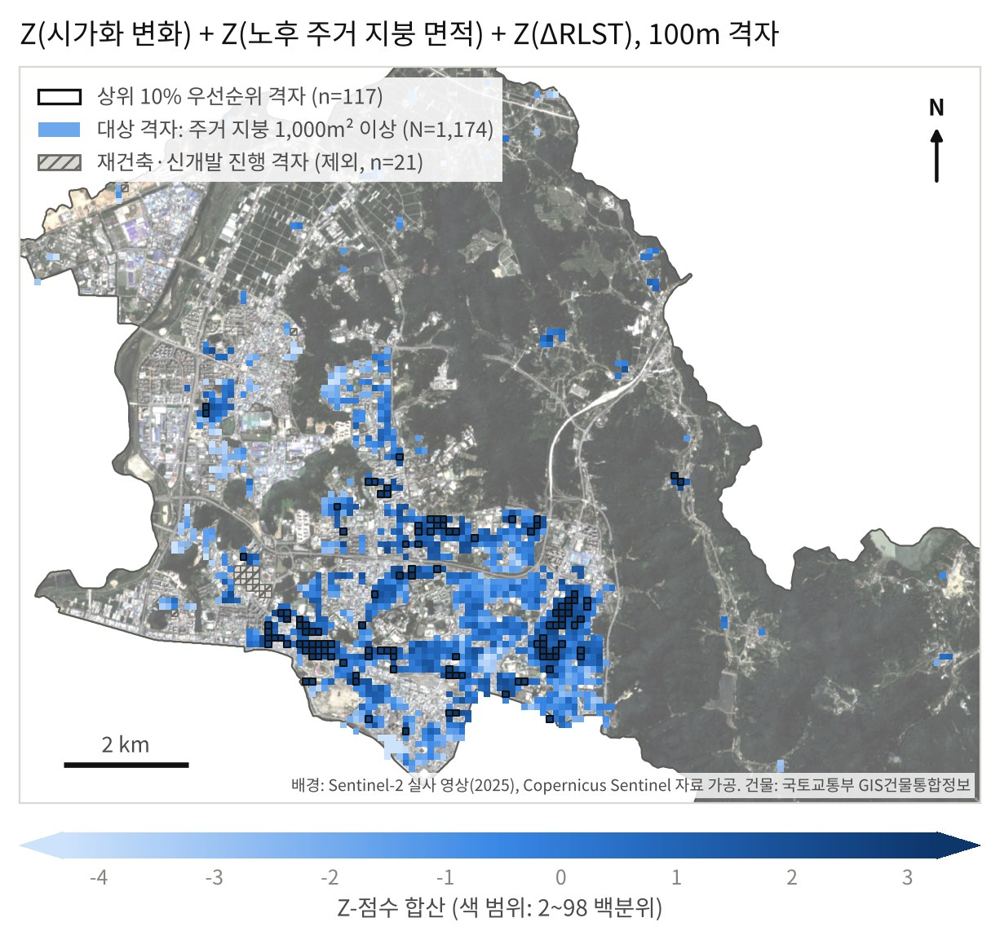

# heatwave — 광주 북구 열환경 분석과 투트랙 폭염 대응 우선순위

광주광역시 북구의 위성 지표면온도, 인구 통계, 건물 자료를 결합해 폭염 대응 우선순위를 두 갈래로 도출하고, 그 결과를 정책실무자가 쓰는 웹 정책지도로 구현한 코드와 자료입니다.

- **Track 1 (단기 구호)**: 집계구 832곳. 점수 = Z(2025년 여름 절대 지표면온도) + Z(65세 이상 인구 비율). 상위 10% 83곳.
- **Track 2 (중장기 개조)**: 100 m 격자 1,174칸. 점수 = Z(ΔNDBI) + Z(1999년 이전 사용승인 주거 건물 지붕 면적) + Z(ΔRLST). 상위 10% 117칸(노후 지붕 약 31.4 ha). 재건축·신개발 진행 격자 21칸은 순위에서 따로 분리합니다.
- **정책지도**: 북구 탄소중립지원센터 누리집 [gbcnsc.or.kr/177](https://www.gbcnsc.or.kr/177)에서 연결되는 정적 웹 지도(Leaflet)입니다.

집계구판 분석(논문 v3)은 [baejjunhwan/ding](https://github.com/baejjunhwan/ding)과 같은 코드·자료이며, 이 저장소는 여기에 Track 2 격자판, Track 1 거주지 기준 노출 점검, 정책지도를 더한 것입니다.

| Track 2 격자판 상위 10% | 정책지도 |
| :---: | :---: |
|  | 저장소의 `web/site/` 폴더가 배포본 그대로입니다 |

## 폴더 구성

| 폴더 | 내용 |
| :--- | :--- |
| `gee/` | Google Earth Engine 스크립트. 지표면온도·NDBI·SAVI 합성, 집계구 면적가중 구역통계, ΔRLST 합성 점검(`drlst_check.js`, `drlst_v4.js`), Track 1 거주지 기준 노출(`track1_residential_lst.js`), Track 2 격자 건물 집계(`track2_grid_buildings.js`, `track2_grid_floors.js`) |
| `analysis/` | 논문(v3) 분석: 격자 회귀·공간오차모형, 집계구 회귀, 집계구판 Track 1·2, 그림 |
| `track2_grid/` | Track 2 100 m 격자판: 입력표 만들기 → 점수·강건성 → 결과표 → 성분 점검 → 지도 그림 |
| `track1_residential/` | Track 1 노출을 집계구 전체 평균 대신 주거용 건물 위 평균으로 바꿨을 때의 비교(강건성 점검) |
| `web/` | 정책지도. `src/`(화면 코드), `build_web_data.py`·`build_grid_t2.py`(자료 변환), `assemble.py`(배포본 조립), `site/`(배포본), `test/`(Playwright 점검) |
| `data/` | 입력 자료(아래 표) |
| `results/`, `figs/` | 산출 결과표와 그림 |

## 실행

```bash
pip install -r requirements.txt
./run_all.sh          # 저장소 최상위에서
```

- Python 3.11 이상, 의존성은 numpy, scipy, pandas, openpyxl, matplotlib, pillow뿐입니다. GDAL이 없어도 되도록 GeoTIFF(LZW)는 `track2_grid/read_lzw_tif.py`로 읽습니다.
- 중간 산출물은 `work/`에 생기며 저장소에는 올리지 않습니다.
- 정책지도의 집계구 경계 자료(`web/site/data/oa.json`)를 다시 만들려면 SGIS 집계구 경계(광주 북구, 2025년 2분기, `bnd_oa_24040_2025_2Q.*`)를 `data/boundary/`에 넣어야 합니다. 없으면 이 단계만 건너뜁니다.
- 정책지도 점검: `cd web/site && python3 -m http.server 8767` 를 띄운 뒤 `node web/test/func.js`, `node web/test/func_t2.js` (Playwright 필요).

## 입력 자료 (`data/`)

논문(v3) 자료의 설명은 [ding 저장소 README](https://github.com/baejjunhwan/ding)와 같습니다. 이 저장소에서 더한 자료는 다음과 같습니다.

| 파일 | 내용 | 만든 방법 |
| :--- | :--- | :--- |
| `buildings/Bukgu_grid100_buildings.tif` | 100 m 격자 칸별 주거 건물 면적(m²): `res_h`·`known_h`·`old_h`(단독·공동주택), `res_m`·`known_m`·`old_m`(근린생활시설 포함) | `gee/track2_grid_buildings.js` |
| `buildings/Bukgu_grid100_floors.tif` | 같은 격자의 노후 주거 건물 면적을 지상층수(4층·5층 이하)로 나눈 값과 층수 결측 면적 | `gee/track2_grid_floors.js` |
| `residential_lst/Bukgu_OA_LST25_residential_house.csv` | 집계구별 2025년 여름 지표면온도: 집계구 전체 평균과 주거 건물(단독·공동주택) 위 평균 | `gee/track1_residential_lst.js` |
| `residential_lst/Bukgu_OA_LST25_residential_mixed.csv` | 위와 같고 근린생활시설 포함 | 〃 |
| `basemap/Sentinel2_TrueColor_2020_Bukgu.tif` | 정책지도 위성 비교용 Sentinel-2 2020년 실사 영상 | GEE |

건물 자료의 원자료는 국토교통부 GIS건물통합정보(광주 북구)이며, 이 저장소에는 원자료가 아니라 격자로 집계한 면적만 담았습니다. "노후 지붕 면적"은 건물 외곽선의 수평투영 면적으로, 지붕 면적의 근사값입니다. GEE 스크립트의 자산 경로(`projects/lateral-plane-500605-i8/assets/...`)는 작성자 계정의 것이므로, 다시 실행하려면 본인 자산으로 올린 뒤 경로를 바꾸십시오.

## 주요 결과

| 항목 | 결과 | 파일 |
| :--- | :--- | :--- |
| Track 2 격자판 | 1,174칸 중 상위 117칸. 행정동별로 운암2동 28칸, 두암2동 16칸, 오치1동 12칸 | `results/Track2_grid.csv` |
| Track 2 강건성 | 로버스트 표준화 ρ=.990, 근린생활시설 포함 107/117 유지, 노후 지붕을 4층 이하로 한정 ρ=.952·104/117 유지 | `results/track2_grid_robustness.json`, `results/track2_component_checks.json` |
| Track 2 성분 영향 | 한 성분을 빼면 상위 117칸 중 노후 지붕 57칸, ΔRLST 73칸, ΔNDBI 87칸 유지 | `results/track2_component_checks.json` |
| Track 1 거주지 기준 노출 | 순위상관 ρ=.963(주택)·.965(근린생활시설 포함), 상위 83곳 중 77곳 유지 | `results/Track1_거주지노출.csv` |
| 정책지도 자료 정합성 | 웹 자료의 Track 1(832곳)·Track 2(1,174칸) 점수·순위가 분석 결과와 전수 일치 | `web/site/data/` |

## 인용

집계구판 분석은 배준환·박현재의 한국기후변화학회지 투고 논문(심사 중)에 대응합니다. 정책지도와 Track 2 격자판은 배준환 박사학위논문(전남대학교 디지털서비스융합학과, 작성 중)의 일부입니다.
